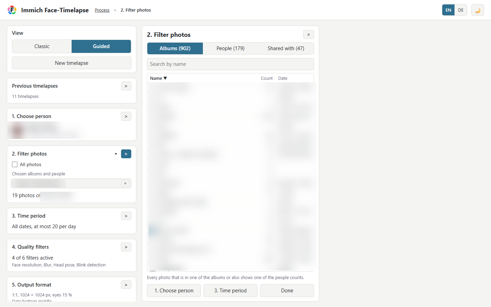
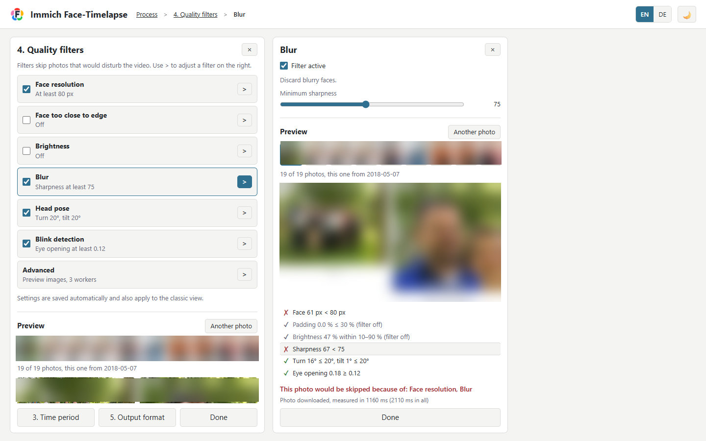
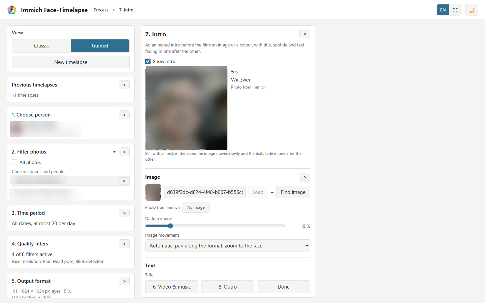
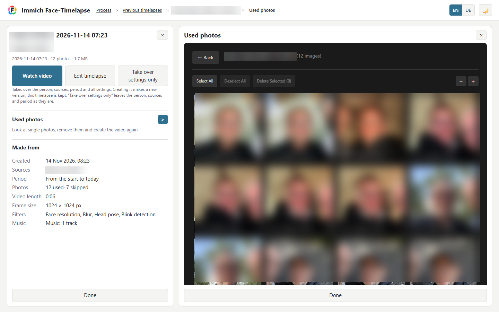
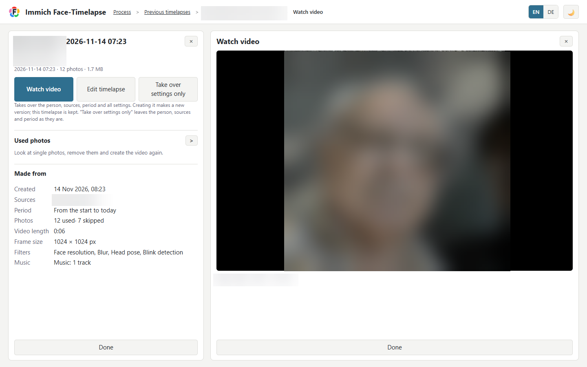

# Immich Face-Timelapse

***Generate timelapse videos of your loved ones' faces from your [Immich](https://immich.app/) photo library.***

Immich Face-Timelapse is a fork of
[ArnaudCrl/immich-automated-selfie-timelapse](https://github.com/ArnaudCrl/immich-automated-selfie-timelapse)
by Arnaud Cayrol. The face pipeline (cropping, alignment, quality filters, video) comes from the original project;
this fork adds a guided, bilingual (English/German) interface, intro and outro, music, sharing and more.
See [What's different from the original](#whats-different-from-the-original).

It uses Immich's face recognition to find all photos of a person, then runs them through a configurable pipeline
that crops, aligns, filters and compiles them into a smooth timelapse video.

<p align="center">
  
</p>

## Screenshots

The guided view leads step by step from the person to the finished video; every step opens its settings in a
panel on the right. *(Photos and names are blurred.)*

**Steps and photo sources**: choose a person, then limit the photos to albums, people or shared albums.



**Quality filters with live preview**: every filter shows its verdict on a sample photo and follows the sliders
instantly.



**Intro and outro**: an animated title with a photo from Immich, an uploaded image or a colour.



**Previous timelapses and photo picking**: every run is kept with its settings; look through the used photos,
remove bad ones and create the video again.



**Result**: watch the video, edit the timelapse or take over its settings for a new one.



## Features

**Face pipeline** (from the original project)

- **Face detection & cropping** using Immich's face recognition metadata
- **Face alignment** on the eye positions for a stable, smooth timelapse
- **Head pose filtering** with an ONNX model (DMHead) to skip photos that don't face the camera
- **Blink detection** (Eye Aspect Ratio), **blur detection** (Sobel), **brightness** and **face size** filters
- **Photo limiting** per day, week or month
- **Video compilation** to MP4 with FFmpeg

**Added in this fork**

- **Guided view**: step by step from person to finished video, with panels for every setting; light and dark mode;
  English and German
- **Photo sources**: limit the photos to albums, to photos together with other people, or (optional) to albums
  shared with someone via Immich Smart Albums
- **Live preview of the quality filters** on a sample photo, following the sliders instantly
- **Pick photos** before creating the video, and re-select photos of a finished timelapse later
- **Aspect ratios** 1:1, 4:5, 5:4, 16:9 and 9:16
- **Date overlay** with many formats, fonts, colours and shadow
- **Animated intro and outro** with a photo from Immich, an uploaded image or a colour, title texts and camera motion
- **Background music** from a folder or uploaded in the UI, fit the video to the music or to a fixed length
- **Versions and history**: every run gets its own folder; previous timelapses with details, "edit" and
  "take over settings"
- **Share videos** via private links on a separate port, with expiry and optional downloads
- **Multi-arch Docker image** (amd64, arm64) on GitHub Container Registry

The full list of changes is in the app under **About → Changelog**.

## Quick start

### 1. Immich API key

Create an API key in Immich under **Account Settings → API Keys**
([Immich docs](https://immich.app/docs/features/command-line-interface#obtain-the-api-key)).
The app only reads from Immich; it never changes or uploads anything. These permissions are enough:

| Permission | Used for |
|---|---|
| `server.about` | Connection check and Immich version |
| `person.read` | List of people and their portraits |
| `face.read` | Face positions in the photos |
| `asset.read` | Searching photos by person, period and album |
| `asset.view` | Thumbnails and previews |
| `asset.download` | Original photos for processing |
| `album.read` | List of albums |

Store the key in a `.env` file next to your `docker-compose.yml` rather than in the compose file itself:

```env
IMMICH_API_KEY=your-api-key
```

### 2. Docker Compose (recommended)

```yaml
services:
  immich-face-timelapse:
    image: ghcr.io/rheckly/immich-face-timelapse:latest
    container_name: immich-face-timelapse
    user: 1000:1000
    ports:
      - "5000:5000"   # web interface - keep it in your local network
      # - "5001:5001" # optional: public share links (see "Sharing videos")
    environment:
      - IMMICH_API_KEY=${IMMICH_API_KEY}
      - IMMICH_BASE_URL=http://your-immich-host:2283
    volumes:
      - ./config:/app/config
      - ./output:/app/output
      - ./music:/app/music   # optional: background music
    restart: unless-stopped
```

Set the folder permissions before the first start:

```bash
mkdir -p config output music && chown -R 1000:1000 config output music
```

Then open **http://your-server:5000**.

Processing is CPU-heavy. The app doesn't need to run all the time, so you can also run it on a faster PC
just for creating timelapses.

### Docker run

```bash
docker run -d \
  --name immich-face-timelapse \
  -p 5000:5000 \
  -e IMMICH_API_KEY=your-api-key \
  -e IMMICH_BASE_URL=http://your-immich-host:2283 \
  -v ./config:/app/config \
  -v ./output:/app/output \
  -v ./music:/app/music \
  ghcr.io/rheckly/immich-face-timelapse:latest
```

### Running next to the original

Image and container have their own names, so both apps can run on the same host. Map a different host port,
e.g. `"5002:5000"`, if the original already uses 5000.

## Configuration

### Environment variables

| Variable | Required | Description |
|---|---|---|
| `IMMICH_API_KEY` | yes | Immich API key (see above) |
| `IMMICH_BASE_URL` | yes | Address of Immich as reachable from the container, e.g. `http://immich-server:2283` |
| `MUSIC_DIR` | no | Music folder inside the container (default `/app/music`) |
| `SHARE_PORT` | no | Port of the public share listener (default `5001`) |
| `SMARTALBUMS_URL` | no | Immich Smart Albums address, enables the "Shared with" source |
| `CONNECT_KEY` | no | Connect key of Immich Smart Albums (sent as `X-Connect-Key`) |
| `UMAMI_URL` | no | Umami server (or its tracker script URL) for usage statistics |
| `UMAMI_WEBSITE_ID` | no | Umami website ID; statistics are off unless both Umami variables are set |

All optional features are simply hidden or off when their variables are missing.

### Volumes

| Path | Description |
|---|---|
| `/app/config` | Settings (`config.toml`), shared links (`shares.json`), uploaded title images, extra fonts in `config/fonts` |
| `/app/output` | One folder per run (`<name>_<YYYY-MM-DD_HHMM>`) with video, frames and `run.json` |
| `/app/music` | *(optional)* Music files (mp3, m4a, aac, wav, flac, ogg, opus); read-only is fine if you don't upload music in the UI |

### Photo sources

In the guided view you can limit the photos of a person to sources:

- **Albums**: photos in one of the chosen albums
- **People**: photos that also show one of the chosen people
- **Shared with** *(optional)*: photos in an album shared with one of the chosen people in Immich Smart Albums

A photo counts if it matches at least one chosen source; nothing chosen means all photos.
The **Shared with** tab is only shown when `SMARTALBUMS_URL` and `CONNECT_KEY` are set.

### Music

Put audio files into the music folder or upload them in the UI. You can:

- select one or more tracks; they play in the numbered order,
- set the fade-out at the end of the video,
- **fit the video to the music**: frame rate = number of images ÷ music length, limited to a minimum and maximum
  frame rate, or choose a **fixed length** instead.

### Sharing videos

Finished videos can be shared with private links. Shared links are served on a **separate port** (`5001`), which
only delivers the share page, the video and, if allowed per link, a download of the video and photos.

To share with people outside your network:

1. publish port 5001 (and only this port) through your reverse proxy, e.g. as `https://share.example.com`,
2. enter this address as **public address** under **Settings** in the app.

Never expose port 5000: the web interface has no login of its own.

### Quality settings

The default filter settings are permissive because every face is different. Adjust brightness, eye aspect ratio
etc. for the person you're processing; the live preview shows how each filter decides.

## Tips

- After preparing the photos, go through them in **Pick photos** and remove the bad ones before creating the
  video. A few outliers always pass the filters, and removing them makes a big difference.
- The original classic single-page view is still included for now; the guided view is the default.

## What's different from the original

This fork started from the original `master` and went its own way:

- new guided, bilingual interface (the classic view is kept)
- photo sources, filter preview, photo picking, aspect ratios, date overlay, intro/outro, music upload
- versioned output, history, shares, settings panel
- own version numbering from 1.0.0 and its own image `ghcr.io/rheckly/immich-face-timelapse`

Changes are not sent back upstream automatically. Issues about this fork belong here, not in the original project.

## Thanks

- **Arnaud Cayrol** ([ArnaudCrl](https://github.com/ArnaudCrl)) for the original
  [immich-automated-selfie-timelapse](https://github.com/ArnaudCrl/immich-automated-selfie-timelapse) and its
  face pipeline. If you like this project, please also star the original.
- The [Immich](https://immich.app/) team and contributors.

## License

[MIT License](LICENSE). Original work © 2025 Arnaud Cayrol; the license and its copyright notice stay with all
copies and modifications.
